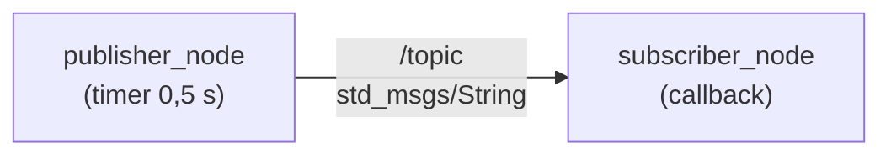
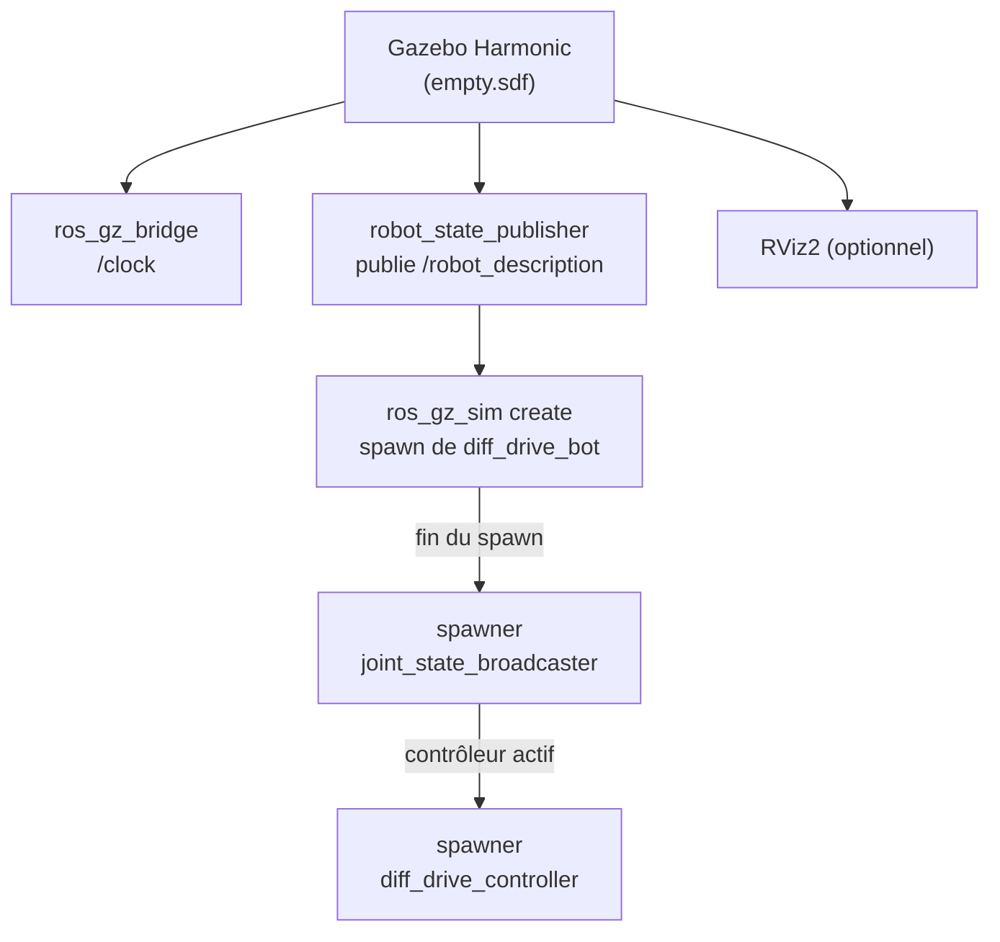

<div align="center">

# ROS 2 Jazzy — Formation pratique

**Des premiers nœuds Python jusqu'à un robot différentiel simulé sous Gazebo**


*Support de code de la formation ROS 2 — XECORAX*

</div>

## Sommaire

1. [À propos](#-à-propos)
2. [Contenu du dépôt](#-contenu-du-dépôt)
3. [Prérequis](#-prérequis)
4. [Installation et compilation](#-installation-et-compilation)
5. [Module 1 — Premiers nœuds Python](#-module-1--premiers-nœuds-python)
6. [Module 2 — Publisher / Subscriber et launch file](#-module-2--publisher--subscriber-et-launch-file)
7. [Module 3 — Décrire un robot (URDF / Xacro) et le visualiser](#-module-3--décrire-un-robot-urdf--xacro-et-le-visualiser)
8. [Module 4 — Simulation Gazebo et ros2_control](#-module-4--simulation-gazebo-et-ros2_control)
9. [Commandes utiles](#-commandes-utiles)
10. [Dépannage](#-dépannage)
11. [Exercices proposés](#-exercices-proposés)
12. [Auteur et licence](#-auteur-et-licence)


## À propos

Ce dépôt contient le **workspace ROS 2** utilisé pendant la formation. Il est volontairement
progressif : chaque package correspond à une étape de l'apprentissage.

| Étape | Package | Ce que vous apprenez |
|---|---|---|
| Concepts & code | `my_py_pkg` | Créer un package Python, écrire des nœuds, publier et s'abonner à un topic |
| Orchestration | `ros2_tutorial_bringup` | Lancer plusieurs nœuds avec un *launch file* |
| Avancé & simulation | `ros_description` | URDF/Xacro, RViz2, Gazebo, `ros_gz`, `ros2_control`, robot différentiel |

> Les exemples de `turtlesim` (nœuds, topics, outils CLI) sont vus en cours, en amont de ce workspace.

## Contenu du dépôt

```text
ros2_tutorial_ws/
├── README.md
├── .gitignore
└── src/
    ├── my_py_pkg/                      # Package Python (ament_python)
    │   ├── my_py_pkg/
    │   │   ├── my_first_node.py        # Hello World Python (sans ROS)
    │   │   ├── second_node.py          # Premier nœud ROS 2 minimal
    │   │   ├── publisher.py            # Publisher en POO  → topic "topic"
    │   │   └── subscriber.py           # Subscriber en POO ← topic "topic"
    │   ├── test/                       # Tests de style (flake8, pep257, copyright)
    │   ├── package.xml
    │   └── setup.py                    # Points d'entrée (console_scripts)
    │
    ├── ros2_tutorial_bringup/          # Package de lancement (ament_cmake)
    │   ├── launch/
    │   │   └── publisher_subscriber.launch.py
    │   ├── package.xml
    │   └── CMakeLists.txt
    │
    └── ros_description/                # Robot + simulation (ament_cmake)
        ├── urdf/diff_drive_bot.urdf.xacro   # Modèle du robot
        ├── config/controllers.yaml          # Contrôleurs ros2_control
        ├── launch/
        │   ├── display.launch.py            # RViz2 + sliders des joints
        │   └── spawn.launch.py              # Gazebo + robot + contrôleurs
        ├── rviz/display.rviz                # Configuration RViz2
        ├── world/                           # Mondes Gazebo (vide pour l'instant)
        ├── package.xml
        └── CMakeLists.txt
```

## Prérequis

| Outil | Version |
|---|---|
| Ubuntu | 24.04 LTS (Noble) |
| ROS 2 | **Jazzy Jalisco** |
| Gazebo | **Harmonic** (installé avec `ros-jazzy-ros-gz`) |
| Python | 3.12 |
| Compilation | `colcon` |

### Installer les dépendances

```bash
sudo apt update
sudo apt install -y \
  ros-jazzy-desktop \
  ros-jazzy-ros-gz \
  ros-jazzy-gz-ros2-control \
  ros-jazzy-ros2-control \
  ros-jazzy-ros2-controllers \
  ros-jazzy-xacro \
  ros-jazzy-joint-state-publisher \
  ros-jazzy-joint-state-publisher-gui \
  ros-jazzy-teleop-twist-keyboard \
  python3-colcon-common-extensions
```

## Installation et compilation

```bash
# 1. Cloner le dépôt
git clone https://github.com/<votre-utilisateur>/ros2_tutorial_ws.git
cd ros2_tutorial_ws

# 2. Charger ROS 2
source /opt/ros/jazzy/setup.bash

# 3. Compiler
colcon build --symlink-install

# 4. Charger le workspace (à refaire dans chaque nouveau terminal)
source install/setup.bash
```

> Ajoutez ces lignes à votre `~/.bashrc` pour ne plus avoir à les retaper :
> ```bash
> source /opt/ros/jazzy/setup.bash
> source ~/ros2_tutorial_ws/install/setup.bash
> ```

Compiler un seul package :

```bash
colcon build --symlink-install --packages-select my_py_pkg
```

## Module 1 — Premiers nœuds Python

Le package `my_py_pkg` expose quatre exécutables, déclarés dans `setup.py` :

| Exécutable | Fichier | Rôle |
|---|---|---|
| `py_hello_world` | `my_first_node.py` | Simple `print` Python : vérifie que le package est bien installé |
| `second_node` | `second_node.py` | Premier vrai nœud ROS 2 : initialise `rclpy`, affiche un log, s'arrête |
| `publisher_node` | `publisher.py` | Publie `"Hello, world: N"` toutes les 0,5 s |
| `subscriber_node` | `subscriber.py` | Affiche chaque message reçu |

```bash
ros2 run my_py_pkg py_hello_world
ros2 run my_py_pkg second_node
```

**Notions abordées :** `rclpy.init()`, `create_node()`, `get_logger()`, `shutdown()`, structure d'un package `ament_python`, `entry_points`.

## Module 2 — Publisher / Subscriber et launch file

### Lancement manuel (2 terminaux)

```bash
# Terminal 1
ros2 run my_py_pkg publisher_node

# Terminal 2
ros2 run my_py_pkg subscriber_node
```

Les deux nœuds communiquent via le topic **`/topic`** (type `std_msgs/msg/String`, QoS depth = 10).



### Lancement avec un launch file

```bash
ros2 launch ros2_tutorial_bringup publisher_subscriber.launch.py
```

Le launch file démarre les deux nœuds en une seule commande. Pour observer le résultat :

```bash
ros2 node list
ros2 topic list
ros2 topic echo /topic
ros2 topic hz /topic
rqt_graph
```

**Notions abordées :** programmation orientée objet avec `Node`, `create_publisher`, `create_subscription`, `create_timer`, callbacks, `LaunchDescription`, séparation *code* / *bringup*.

## Module 3 — Décrire un robot (URDF / Xacro) et le visualiser

Le package `ros_description` décrit un **robot mobile à entraînement différentiel**.

### Caractéristiques du robot

| Élément | Valeur |
|---|---|
| Châssis | Boîte 0,30 × 0,25 × 0,08 m — 2,0 kg |
| Roues motrices | 2 cylindres, rayon 0,05 m, largeur 0,03 m — 0,3 kg chacune |
| Entraxe des roues | 0,28 m (roues à y = ±0,14 m) |
| Roue folle (caster) | Sphère de rayon 0,02 m, **friction nulle** |
| Joints des roues | `continuous`, axe Y |
| Repères | `base_footprint` → `base_link` → `left_wheel`, `right_wheel`, `caster_wheel` |

### Visualiser dans RViz2

```bash
ros2 launch ros_description display.launch.py
```

Une fenêtre de sliders (`joint_state_publisher_gui`) permet de faire tourner les roues à la main.

| Argument | Défaut | Description |
|---|---|---|
| `model` | `urdf/diff_drive_bot.urdf.xacro` | Chemin du fichier URDF ou Xacro |
| `rvizconfig` | `rviz/display.rviz` | Configuration RViz2 |
| `use_joint_state_publisher_gui` | `true` | `false` pour utiliser la version sans interface |
| `use_sim_time` | `false` | Utiliser `/clock` de la simulation |

Exemple :

```bash
ros2 launch ros_description display.launch.py use_joint_state_publisher_gui:=false
```

Vérifier le modèle :

```bash
xacro src/ros_description/urdf/diff_drive_bot.urdf.xacro > /tmp/robot.urdf
check_urdf /tmp/robot.urdf    # nécessite : sudo apt install liburdfdom-tools
ros2 run tf2_tools view_frames
```

**Notions abordées :** `link`, `joint`, `inertial`, `visual` / `collision`, Xacro, `robot_state_publisher`, TF, RViz2.

## Module 4 — Simulation Gazebo et ros2_control

```bash
ros2 launch ros_description spawn.launch.py
```

| Argument | Défaut | Description |
|---|---|---|
| `use_sim_time` | `true` | Synchronise les nœuds sur le `/clock` de Gazebo |
| `rviz` | `true` | Lance RViz2 en plus de Gazebo |

Sans RViz :

```bash
ros2 launch ros_description spawn.launch.py rviz:=false
```

### Ce que fait ce launch file



L'enchaînement est assuré par des `RegisterEventHandler(OnProcessExit(...))` : chaque contrôleur attend que l'étape précédente soit terminée.

> ℹLe plugin `gz_ros2_control` démarre **lui-même** le `controller_manager`. Le launch file ne le lance donc pas : il se contente de charger les contrôleurs avec les *spawners*.

### Contrôleurs (`config/controllers.yaml`)

| Paramètre | Valeur |
|---|---|
| Fréquence du `controller_manager` | 100 Hz |
| Fréquence de publication | 50 Hz |
| Entraxe / rayon des roues | 0,28 m / 0,05 m |
| Vitesse linéaire max | ± 0,5 m/s (accélération ± 1,0 m/s²) |
| Vitesse angulaire max | ± 1,5 rad/s (accélération ± 2,0 rad/s²) |
| Timeout de commande | 0,5 s (sans commande → arrêt) |
| Repères d'odométrie | `odom` → `base_footprint` |

### Piloter le robot

Le contrôleur écoute sur `/diff_drive_controller/cmd_vel`. Vérifiez d'abord le type attendu :

```bash
ros2 topic info /diff_drive_controller/cmd_vel
```

Puis envoyez une commande (exemple avec un `TwistStamped` simple) :

```bash
ros2 topic pub -r 10 /diff_drive_controller/cmd_vel geometry_msgs/msg/TwistStamped "{header: {stamp: now, frame_id: 'base_link'}, twist: {linear: {x: 0.3}, angular: {z: 0.0}}}"
```

### Observer et diagnostiquer

```bash
ros2 control list_controllers
ros2 control list_hardware_interfaces
ros2 topic echo /diff_drive_controller/odom
ros2 topic echo /joint_states
```

**Notions abordées :** Gazebo, `ros_gz_sim`, `ros_gz_bridge`, `ros2_control`, `joint_state_broadcaster`, `diff_drive_controller`, odométrie, gestion de l'ordre de démarrage.

## ⌨Commandes utiles

| Objectif | Commande |
|---|---|
| Compiler | `colcon build --symlink-install` |
| Recompiler un package | `colcon build --symlink-install --packages-select <pkg>` |
| Nettoyer | `rm -rf build install log` |
| Lister les nœuds | `ros2 node list` |
| Lister les topics | `ros2 topic list -t` |
| Voir un message | `ros2 topic echo <topic>` |
| Fréquence d'un topic | `ros2 topic hz <topic>` |
| Voir les interfaces | `ros2 interface show std_msgs/msg/String` |
| Graphe des nœuds | `rqt_graph` |
| Arbre des TF | `ros2 run tf2_tools view_frames` |

## Dépannage

| Problème | Piste de solution |
|---|---|
| `Package 'xxx' not found` | Avez-vous fait `source install/setup.bash` dans **ce** terminal ? |
| `colcon: command not found` | `sudo apt install python3-colcon-common-extensions` |
| Erreur à la compilation de `ros_description` sur `world` | Le dossier `world/` doit exister (il contient un `.gitkeep`) |
| Le robot ne bouge pas | `ros2 control list_controllers` : les deux contrôleurs doivent être `active` |
| Le robot ne répond pas à la commande | Vérifier le **type** du topic (`Twist` ou `TwistStamped`) avec `ros2 topic info` |
| `gz_ros2_control` introuvable | `sudo apt install ros-jazzy-gz-ros2-control` |
| Gazebo ne démarre pas ou reste noir | Mettre à jour les pilotes graphiques, tester avec `LIBGL_ALWAYS_SOFTWARE=1` |
| Les changements Python ne sont pas pris en compte | Compiler avec `--symlink-install` puis relancer le nœud |

## Exercices proposés

1. **Hello ROS** — Modifier `second_node.py` pour afficher un message toutes les secondes avec un timer.
2. **Message personnalisé** — Changer le contenu publié par `publisher.py` et la fréquence (paramètre `0.5`).
3. **Deux subscribers** — Lancer deux `subscriber_node` et observer le comportement dans `rqt_graph`.
4. **Launch file** — Ajouter un *remapping* du topic `topic` vers `chat` dans `publisher_subscriber.launch.py`.
5. **Paramètres** — Rendre la fréquence du publisher configurable via un paramètre ROS 2.
6. **Robot** — Changer la couleur du châssis et la taille des roues dans le Xacro, puis mettre à jour `wheel_radius` dans `controllers.yaml`.
7. **Capteur** — Ajouter un lidar ou une caméra au robot et les relier à ROS 2 avec `ros_gz_bridge`.
8. **Monde** — Créer un monde Gazebo dans `world/` et le charger depuis `spawn.launch.py`.
